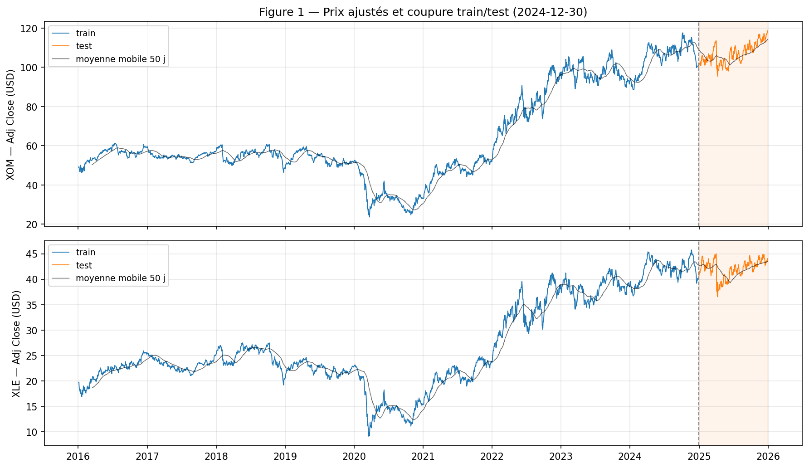
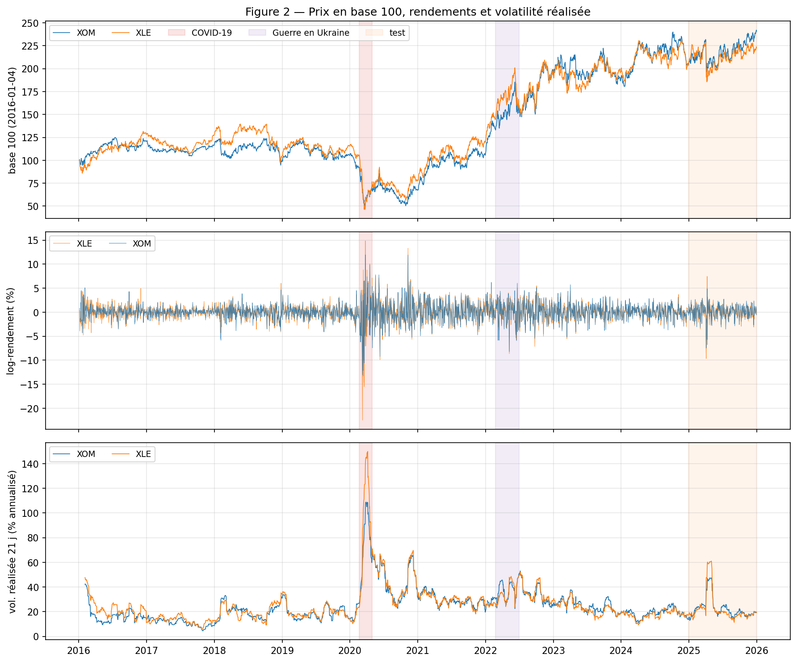
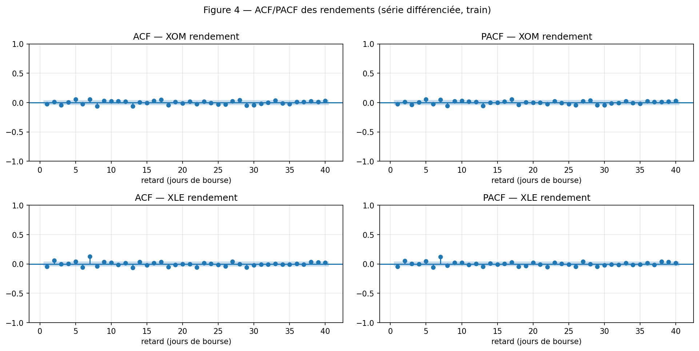
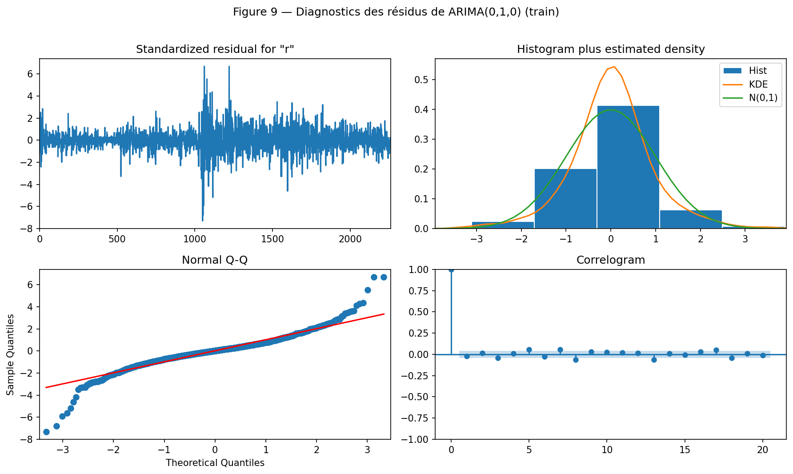
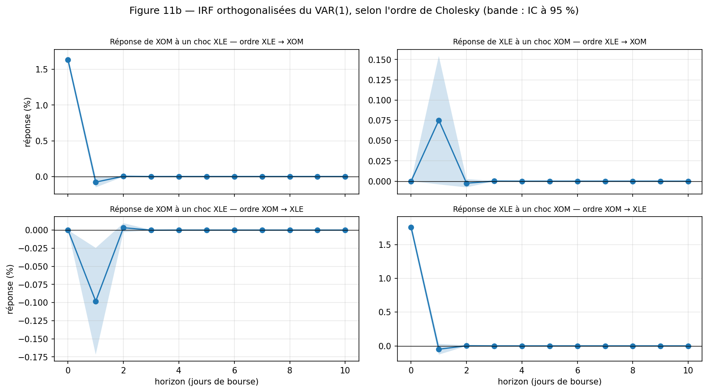
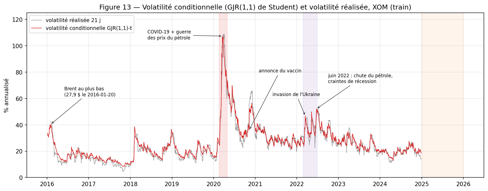
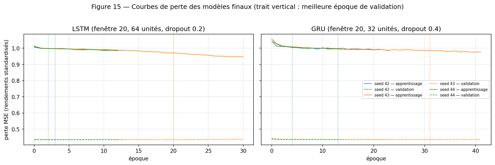
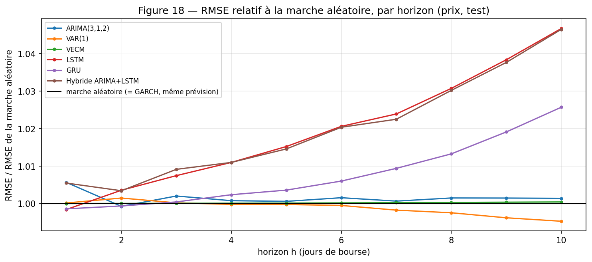
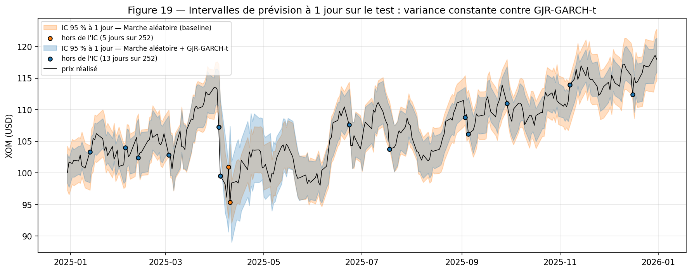
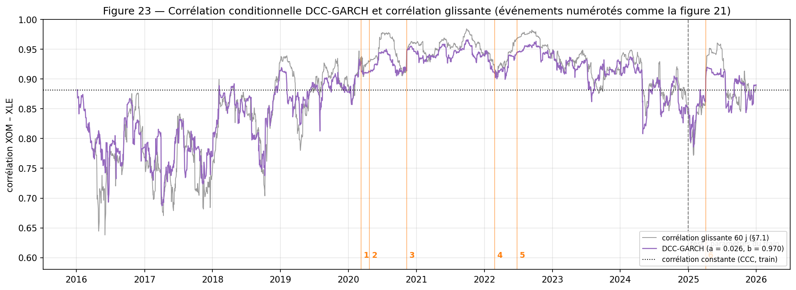

```{=openxml}
<w:p><w:r><w:br w:type="page"/></w:r></w:p>
```

# Résumé

Nous étudions le cours journalier de l'action ExxonMobil (XOM) et de l'ETF sectoriel de l'énergie (XLE) de 2016 à 2025 (2 514 jours de bourse, Yahoo Finance), avec le Brent comme variable externe. La question posée est double : **peut-on prévoir le prix de XOM à 1-10 jours mieux qu'une marche aléatoire, et peut-on prévoir son risque ?**

Les log-prix sont intégrés d'ordre 1 (ADF et KPSS concordants) ; les rendements sont un bruit blanc en moyenne mais fortement hétéroscédastiques. Le critère BIC retient la marche aléatoire, ARIMA(0,1,0) ; le VAR ne révèle aucune prédictibilité croisée robuste ; la cointégration XOM-XLE est faible (Johansen à 10 % seulement) ; un GJR-GARCH(1,1) à loi de Student capte l'effet de levier (γ = 0,042, p = 0,004). Les réseaux LSTM et GRU, validés en walk-forward, ne battent pas la marche aléatoire.

Sur l'année de test (252 origines, ré-estimation tous les 20 jours), **aucun modèle n'est significativement meilleur que la marche aléatoire** selon le test de Diebold-Mariano, et les réseaux sont significativement moins bons à 10 jours. En revanche, **le GJR-GARCH-t est le seul modèle dont les intervalles à 95 % ont une couverture correcte** (94,8 %, contre 98 % pour les modèles à variance constante), avec des intervalles 16 % plus étroits. Le modèle final est donc ARIMA(0,1,0) + GJR-GARCH(1,1)-t : le prix n'est pas prévisible, son risque l'est. Les extensions montrent une corrélation XOM-XLE dynamique (DCC-GARCH) et un Brent explicatif le jour même mais pas prédictif. Un LLM (ChatGPT) a été utilisé de façon critique : il reformule bien des résultats vérifiés mais commet des erreurs de raisonnement que nous documentons.

Le socle classique (section 4) est implémenté en Python **et** en R, avec une comparaison de 91 grandeurs ; la partie avancée (section 5) et les extensions (section 7) sont en **Python uniquement**, sauf les vérifications R indiquées.

```{=openxml}
<w:p><w:r><w:br w:type="page"/></w:r></w:p>
```

# 1. Introduction

## 1.1 Thématique et question de modélisation

Nous avons retenu l'option A du cahier des charges (finance). La série principale est le cours ajusté de **ExxonMobil (XOM)**, première capitalisation pétrolière américaine. Elle est étudiée avec l'**ETF Energy Select Sector SPDR (XLE)**, dont XOM est le premier composant (environ un quart de l'ETF en 2026), et avec le **Brent** (contrat à terme `BZ=F`) comme variable externe.

Ce couple action / secteur se prête à toute la chaîne de modélisation du cahier : deux séries I(1) pour la cointégration, des rendements à effets ARCH pour le GARCH, un lien contemporain fort pour le VAR et la corrélation dynamique.

**Question de modélisation.** Un investisseur peut-il prévoir le prix de XOM à 1, 5 et 10 jours mieux qu'en supposant que demain ressemblera à aujourd'hui (marche aléatoire) ? Et, à défaut, peut-il prévoir l'**amplitude** des variations, c'est-à-dire le risque ?

## 1.2 Démarche et livrables

Le projet suit l'ordre du cahier : données (§2), analyse exploratoire (§3), modèles classiques (§4), modèles avancés (§5), prévision et évaluation sur le test (§6), extensions (§7), usage critique d'un LLM (§8), discussion (§9).

| Livrable | Contenu |
| ------------------------ | ---------------------------------------- |
| `notebooks/main_python.ipynb` | Étude complète de bout en bout (sections 1 à 7), exécutable sans intervention |
| `notebooks/classical_R.Rmd` (+ `.html`) | Socle classique en R (sections 1 à 3) et comparaison avec Python, vérifications de Diebold-Mariano et du DCC |
| `src/*.py` | Logique Python (données, EDA, modèles classiques, réseaux, évaluation, extensions) |
| `llm/` | Interprétation personnelle, prompts, réponses intégrales du LLM, comparaison |
| `docs/journal.md`, `docs/sources.md` | Résultats et décisions par phase ; sources des faits externes |

Toutes les valeurs citées dans ce rapport proviennent d'une exécution réelle du code. La graine est fixée à 42 partout et les versions des packages sont figées.

# 2. Données et préparation

## 2.1 Source et variables

Les cours journaliers viennent de Yahoo Finance (`yfinance`, colonne **Adj Close**, ajustée des dividendes et des divisions), du 2016-01-01 au 2025-12-31. Le Close de XOM au 2016-01-04 vaut 77,46 $, son Adj Close 49,00 $ : sans ajustement, chaque détachement de dividende créerait une fausse baisse.

Yahoo recalcule l'Adj Close à chaque nouveau dividende. Pour garantir des résultats reproductibles, les données téléchargées le 2026-11-08 sont **figées dans un cache versionné** (`data/raw/`), relu en priorité par Python et par R.

| Variable | Définition | Rôle |
| ---------------- | -------------------------------- | ------------------------ |
| Prix ajusté $P_t$ | Adj Close | Métriques d'évaluation (en dollars) |
| Log-prix | $\ln P_t$ | Stationnarité, cointégration |
| Rendement $r_t$ | $100 	imes \Delta \ln P_t$ (en %) | Variable modélisée (ARIMA, VAR, GARCH, réseaux) |
| Volatilité réalisée | écart-type des rendements sur 21 jours × √252 | Indicateur de risque, entrée des réseaux |
| Moyenne mobile | 50 jours | Indicateur technique (graphiques) |

Toutes les fenêtres glissantes ne regardent que le passé, ce qui évite toute fuite d'information du test vers le train.

## 2.2 Valeurs manquantes et calendrier

XOM et XLE ont exactement le même calendrier : 2 514 jours de bourse, sans valeur manquante ni doublon. Le Brent, coté sur un autre marché, manque 2 jours du calendrier commun (2016-10-10 et 2016-11-11) ; 3 cotations hors calendrier sont écartées.

**Choix : pas d'imputation.** Un remplissage par la valeur de la veille (ffill) créerait des rendements nuls fictifs, qui biaiseraient le GARCH à la baisse. Les modèles reçoivent un index positionnel (jours de bourse successifs) ; les dates ne servent qu'aux graphiques.

## 2.3 Découpage chronologique

| Échantillon | Jours | Période |
| ---------------- | -------- | ------------------------ |
| Train (90 %) | 2 262 | 2016-01-04 → 2024-12-27 |
| Test (10 %) | 252 | 2024-12-30 → 2025-12-31 |

Le découpage est chronologique, sans mélange. Toute l'identification (tests, choix des ordres, hyperparamètres) se fait sur le train uniquement.

{width=16cm}

**Interprétation.** Les deux prix évoluent ensemble : effondrement de 2020, forte hausse de 2021-2022, plateau ensuite. **Le test est plus calme que le train** : la volatilité réalisée maximale de XOM y atteint 47,4 %, contre 108,9 % sur le train. Toutes les métriques du test reflètent ce régime, ce qu'il faudra rappeler en section 6.

# 3. Analyse exploratoire (train)

## 3.1 Statistiques descriptives

| Rendements (%) | Moyenne | Écart-type | Volatilité annualisée | Skewness | Excès de kurtosis | Jarque-Bera |
| ---------------- | ---------- | ----------- | ------------- | ----------- | ------------ | ------------------- |
| XOM | 0,032 | 1,78 | 28,3 % | −0,16 | 6,6 | 4 142 (p < 0,0001) |
| XLE | 0,031 | 1,92 | 30,5 % | −0,89 | 16,4 | 25 747 (p < 0,0001) |

- **La moyenne n'est pas significative.** H₀ : espérance nulle. Le test t avec erreurs-types HAC (Newey-West, 7 retards) donne t = 0,86, p = 0,39 pour XOM : on ne rejette pas H₀. Le modèle de moyenne n'aura pas besoin de constante.
- **La normalité est rejetée.** Jarque-Bera (H₀ : normalité) rejette très nettement : queues épaisses (excès de kurtosis de 6,6 et 16,4) et asymétrie négative. Conséquence : loi de Student pour le GARCH, et diagnostic de normalité par Jarque-Bera plutôt que Shapiro-Wilk, qui rejette toujours sur 2 000 points.

{width=16cm}

**Interprétation.** Les rendements oscillent autour de zéro, mais leur amplitude varie fortement : des périodes calmes alternent avec des grappes de fortes variations (début 2016, mars-avril 2020, 2022, avril 2025). C'est la signature de l'hétéroscédasticité conditionnelle, que le GARCH modélisera.

## 3.2 Autocorrélations

- **Log-prix :** ACF(1) = 0,998, décroissance très lente (40 retards sur 40 significatifs), un seul pic de PACF au retard 1 : profil typique d'une marche aléatoire.
- **Rendements :** les autocorrélations sont minuscules (|ACF| ≤ 0,064 pour XOM).
- **Rendements au carré :** 40 retards sur 40 significatifs, ACF maximale de 0,32.

{width=15cm}

**Test de Ljung-Box.** H₀ : pas d'autocorrélation jusqu'au retard 10.

| Rendements de XOM | Q(10) / p-value | Décision |
| -------------------------------- | -------------------- | ---------------- |
| Bruts | 34,9 ; p = 0,0001 | H₀ rejetée |
| Standardisés par la volatilité des 21 jours précédents | p = 0,98 | H₀ non rejetée |
| Hors année 2020 | p = 0,44 | H₀ non rejetée |
| Au carré | Q(10) = 1 464 ; p < 0,0001 | H₀ rejetée |

**Interprétation.** Le rejet sur les rendements bruts disparaît dès qu'on neutralise la volatilité ou qu'on retire 2020 : c'est un **artefact de l'hétéroscédasticité**, pas une vraie dynamique de la moyenne. Les rendements sont un bruit blanc en moyenne, mais leur variance est très prévisible (rendements au carré).

## 3.3 Saisonnalité et valeurs aberrantes

- **Pas de saisonnalité.** La décomposition STL donne une force saisonnière F_S = 0,000 pour une période de 5 jours et 0,000 pour 252 jours (0,032 pour 21 jours). Il n'y a pas d'effet jour de la semaine sur la moyenne (Kruskal-Wallis, H₀ : même distribution chaque jour : p = 0,59).
- **Valeurs aberrantes.** Détection par intervalle interquartile glissant sur les 63 jours précédents (k = 3) : 15 jours pour XOM, 18 pour XLE, dont 10 chacun en 2020. Elles sont **conservées** : ce sont des chocs réels, communs aux deux actifs, et précisément ce que le GARCH doit modéliser. Une variable indicatrice est créée. La détection est robuste : un noyau de 11 jours (XOM) est retrouvé par au moins 12 réglages sur 16.

## 3.4 Stationnarité : ADF et KPSS

Les deux tests ont des hypothèses nulles **opposées** : ADF, H₀ = racine unitaire (non stationnaire) ; KPSS, H₀ = stationnarité. On conclut quand ils concordent.

| Série (train) | Spécification | ADF : stat. (retards), p | KPSS : stat. (retards), p | Conclusion |
| -------------- | -------------- | ------------------- | ------------------- | -------------- |
| Log-prix XOM | constante | −0,971 (18), p = 0,76 | 3,563 (29), p < 0,01 | non stationnaire |
| Log-prix XOM | constante + tendance | −1,600 (18), p = 0,79 | 1,397 (29), p < 0,01 | non stationnaire |
| Rendements XOM | constante | −10,557 (17), p < 0,001 | 0,144 (8), p > 0,10 | stationnaire |
| Log-prix XLE | constante | −1,503 (7), p = 0,53 | 3,586 (29), p < 0,01 | non stationnaire |
| Rendements XLE | constante | −16,064 (6), p < 0,001 | 0,084 (9), p > 0,10 | stationnaire |

Les retards de l'ADF sont choisis par AIC ; les valeurs critiques à 5 % sont −2,86 (constante) et −3,41 (constante + tendance) pour l'ADF, 0,463 et 0,146 pour le KPSS.

**Robustesse aux ruptures.** Une rupture structurelle peut faire croire à tort à une racine unitaire. Le test de Zivot-Andrews (H₀ : racine unitaire, avec une rupture endogène) ne rejette pas non plus : p de 0,18 à 0,48, ruptures estimées en janvier 2020 et décembre 2021.

**Conclusion : d = 1, D = 0.** Les log-prix sont I(1), les rendements I(0). On modélise donc les rendements, et non les prix.

# 4. Modélisation classique (Python et R)

## 4.1 ARIMA et SARIMA

**Convention.** Un ARIMA(p,1,q) du log-prix est estimé comme un ARMA(p,q) des rendements en %. La constante éventuelle est alors la dérive du prix, et tous les modèles portent sur les mêmes 2 261 observations, ce qui rend leurs AIC et BIC comparables. Les erreurs-types sont robustes (QMLE), à cause des effets ARCH.

| Modèle | AIC | BIC | Coefficients (p-value robuste) |
| ------------------------ | ---------- | ---------- | --------------------------- |
| **ARIMA(0,1,0)** | **9 037,10** | **9 042,83** | — |
| ARIMA(1,1,0) | 9 037,84 | 9 049,29 | AR(1) = −0,024 (p = 0,49) |
| ARIMA(0,1,1) | 9 037,87 | 9 049,32 | MA(1) = −0,023 (p = 0,50) |
| ARIMA(0,1,0) + dérive | 9 038,38 | 9 049,83 | dérive = 0,032 (p = 0,40) |
| ARIMA(3,1,2) (auto_arima, AIC) | 9 021,27 | 9 055,6 | racines AR et MA quasi identiques |

- **Identification manuelle (Box-Jenkins).** L'ACF et la PACF des rendements ne montrent aucun pic net : les candidats de petit ordre ont tous des coefficients non significatifs, et la marche aléatoire a le meilleur AIC et le meilleur BIC.
- **Recherche automatique.** `pmdarima.auto_arima` exhaustif (p, q ≤ 5) choisit ARIMA(3,1,2) avec l'AIC (−15,8 points), mais ARIMA(0,1,0) avec le BIC. L'ARIMA(3,1,2) est suspect : ses racines AR (module 1,047) et MA (module 1,075) se compensent presque, ses résidus standardisés restent autocorrélés (Ljung-Box p = 0,013), et son gain d'AIC devient une perte (+9,2) sur rendements standardisés. En R, l'optimiseur s'arrête même sur un autre maximum local de sa vraisemblance (§4.4).
- **SARIMA, s = 5.** Le terme saisonnier améliore l'AIC (−5,7) et le test du rapport de vraisemblance (p = 0,006), mais son coefficient n'est pas significatif avec des erreurs-types robustes (0,058, p = 0,12), le BIC est inchangé (+0,05) et le gain disparaît hors 2020. Avec une force saisonnière STL nulle, **le SARIMA est écarté**.

**Diagnostic des résidus de la marche aléatoire.** Ljung-Box sur résidus standardisés : p = 0,98 (pas d'autocorrélation) ; Jarque-Bera = 4 142 (normalité rejetée) ; ARCH-LM(5) = 441, p < 0,0001 (H₀ : pas d'effet ARCH, rejetée).

{width=15cm}

**Décision.** ARIMA(0,1,0) sans dérive (marche aléatoire). La moyenne est correctement modélisée, mais la variance ne l'est pas : il faut un GARCH (§4.3). L'ARIMA(3,1,2) est conservé comme concurrent pour l'évaluation hors échantillon.

## 4.2 VAR, causalité de Granger, cointégration et VECM

**VAR sur les rendements.** L'AIC choisit 9 retards, le BIC 0. Hors 2020 et sur rendements standardisés, les quatre critères choisissent 0 retard : le saut de l'AIC vient de 2020. Le test de Portmanteau (Hosking, codé à la main) sur résidus standardisés confirme : VAR(0) p = 0,77, VAR(1) p = 0,038, VAR(7) et VAR(9) p < 0,0001. Ajouter des retards crée de la structure parasite. Les résidus des deux équations ont une corrélation de **0,915** : le lien entre XOM et XLE est **contemporain**.

**Causalité de Granger** (H₀ : le passé de XLE n'améliore pas la prévision de XOM). Le test F classique rejette (p = 0,009), mais avec des erreurs-types robustes à l'hétéroscédasticité (HC3), p = 0,20 : on ne rejette pas H₀. Hors 2020, aucun test robuste ne rejette à 5 %. Il n'y a donc **pas de prédictibilité croisée robuste**. Rappelons que Granger mesure une prédictibilité, pas une causalité.

**Réponses impulsionnelles et décomposition de la variance.** Un choc d'un écart-type sur XLE fait varier XOM de +1,63 % le jour même, de −0,08 % le lendemain, puis l'effet est nul, quel que soit l'ordre de Cholesky. La FEVD attribue 83,7 % de la variance de XOM à XLE si XLE est placé en premier, mais 0,3 % si XOM est placé en premier. Ce 83,7 % est exactement 0,915² : la FEVD ne fait qu'attribuer la covariance du jour même à la variable placée en premier. **On ne peut donc pas dire qui entraîne qui** sans restrictions supplémentaires (SVAR).

{width=15cm}

**Cointégration des log-prix.**

| Test | H₀ | Statistique | p-value / seuil | Décision |
| ------------------------ | ---------------- | ---------- | --------------------- | -------------- |
| Engle-Granger (constante) | pas de cointégration | — | p = 0,037 | rejet à 5 % |
| Engle-Granger (constante + tendance) | pas de cointégration | — | p = 0,105 | non rejet |
| Johansen, trace (r = 0) | pas de relation | 14,73 | VC 10 % = 13,43 ; VC 5 % = 15,49 | rejet à 10 % seulement |
| Engle-Granger, 2016-2019 / 2021-2024 | pas de cointégration | — | p = 0,081 / 0,232 | non rejet |

**Interprétation.** La cointégration est **faible et fragile** : elle n'est acceptée qu'à 10 % par Johansen, dépend de la spécification, et disparaît dans chaque sous-période. Le VECM est estimé conditionnellement (rang 1, constante dans la relation) : β = (1 ; −1,128), soit ln XOM ≈ 1,128 ln XLE + 0,453 à long terme. Les coefficients d'ajustement ont le signe attendu mais ne sont pas significatifs (α_XOM = −0,0006, p = 0,93 ; α_XLE = +0,0093, p = 0,16). La demi-vie d'un écart à l'équilibre, ln(0,5)/ln(1 + β'α), vaut 62,6 jours de bourse : en 10 jours, la correction ne résorbe qu'environ 10 % d'un écart.

## 4.3 Volatilité conditionnelle : GARCH

**Effet ARCH.** Sur les résidus de la marche aléatoire, ARCH-LM(5) = 441,2 (p < 0,0001) : la variance n'est pas constante.

**Choix du modèle.** Nous avons comparé 4 structures (GARCH(1,1), GJR(1,1), GARCH(1,2), GARCH(2,1)) et 3 lois (normale, Student, Student asymétrique), avec une moyenne nulle. La loi de Student améliore la log-vraisemblance d'environ 37 points par rapport à la normale ; la loi asymétrique et les ordres supérieurs n'apportent rien. Le **GJR(1,1) à loi de Student** a le meilleur AIC et le meilleur BIC.

| Paramètre | Valeur | p-value | Lecture |
| ------------ | -------- | -------- | -------------------------------- |
| ω | 0,0094 | 0,066 | constante de la variance |
| α | 0,043 | < 0,001 | réaction aux chocs |
| γ (levier) | 0,042 | 0,004 | supplément de réaction aux chocs négatifs |
| β | 0,935 | < 0,001 | mémoire de la variance |
| ν | 7,47 | < 0,001 | degrés de liberté (queues épaisses) |

- **Effet de levier.** H₀ : γ = 0. Avec p = 0,004, on rejette H₀. Une baisse augmente la volatilité du lendemain de α + γ = 0,085, contre α = 0,043 pour une hausse de même taille : environ deux fois plus.
- **Persistance.** α + β + γ/2 = 0,9993 sur le train (< 1 : stationnarité respectée de justesse). Cette valeur est **gonflée par la rupture de 2020** : sur 2016-2019, elle n'est que de 0,893 (demi-vie de 6 jours), contre 0,996 sur 2021-2024. Un GARCH confond un changement de niveau de la volatilité avec une forte persistance (Lamoureux et Lastrapes, 1990).
- **Résidus standardisés.** Ljung-Box sur z : p = 0,97 ; ARCH-LM(5) passe de 441 à 14,0 (−97 %), mais reste significatif (p = 0,016) ; Kolmogorov-Smirnov contre la loi de Student : p = 0,46. Le modèle capte l'essentiel de l'hétéroscédasticité, sans la supprimer entièrement.

{width=16cm}

**Interprétation.** La volatilité estimée suit la volatilité réalisée (corrélation de 0,97). Ses pics correspondent à des événements sourcés : 107,4 % le 2020-03-19 (guerre des prix OPEP+ et COVID-19), 46,9 % le 2022-03-16 (invasion de l'Ukraine), 52,2 % le 2022-06-24 (chute du secteur de l'énergie). Le GARCH prévoit **l'amplitude** des variations, jamais leur sens.

## 4.4 Reproduction en R et comparaison avec Python

Le socle classique (sections 2 à 4) est reproduit en R (`quantmod`, `forecast`, `urca`, `vars`, `rugarch`) dans `classical_R.Rmd`, sur le même cache de données. Sur **91 grandeurs comparées**, 71 sont identiques (écart < 0,1 %), 14 très proches (< 2 %) et 6 diffèrent davantage. **Aucune conclusion ne change.**

Chaque écart a une cause identifiée et vérifiée en imposant le même réglage dans les deux langages : échantillon utilisé pour choisir les retards de l'ADF et d'Engle-Granger, point de départ de l'optimiseur de l'ARIMA(3,1,2), ordres testés par `VARselect` (qui ne teste pas l'ordre 0), variance initiale du GARCH. Deux écarts sont instructifs : la vraisemblance de l'ARIMA(3,1,2) a plusieurs maxima (son choix par l'AIC est instable), et le test d'Engle-Granger est sensible aux toutes premières observations (la cointégration est fragile).

# 5. Modélisation avancée : réseaux récurrents (Python uniquement)

## 5.1 Protocole

- **Cible :** les 10 rendements suivants de XOM, prévus d'un coup (sortie directe), puis le prix reconstruit par $\hat P_{t+h} = P_t \exp\left(\sum_{j \le h} \hat r_{t+j}/100\right)$. On n'entraîne jamais un réseau sur les prix bruts, qui ne sont pas stationnaires.
- **Entrées :** fenêtres glissantes de 20 ou 60 jours de trois variables : rendements de XOM et de XLE, volatilité réalisée de XOM.
- **Validation :** walk-forward en 5 folds à fenêtre croissante sur le train (`TimeSeriesSplit`), avec un écart de 10 jours entre apprentissage et évaluation pour que les cibles ne se chevauchent pas. Le k-fold classique est exclu.
- **Entraînement :** normalisation ajustée sur la partie apprentissage de chaque fold ; arrêt précoce (patience 10) sur les 10 % finaux de l'apprentissage, avec restauration des meilleurs poids ; 3 graines (42, 43, 44).
- **Grille réduite :** LSTM et GRU × fenêtre {20, 60} × unités {32, 64} × dropout {0,2 ; 0,4}, soit 16 configurations et 80 entraînements. Le critère est le gain moyen face à la prévision nulle, calculé sur les mêmes échantillons (le RMSE brut n'est pas comparable entre fenêtres).

## 5.2 Résultats

Les 16 configurations perdent toutes face à la marche aléatoire (gain moyen de −0,14 % à −0,43 %). Configurations retenues : LSTM (20 ; 64 ; 0,2) et GRU (20 ; 32 ; 0,4).

| RMSE moyen sur les 5 folds (rendements, %) | Valeur |
| ---------------------------------------- | ------------ |
| **Marche aléatoire (prévision nulle)** | **1,8450** |
| Moyenne d'apprentissage | 1,8457 |
| LSTM | 1,8472 |
| GRU | 1,8482 |
| ARIMA(3,1,2) | 1,8501 |
| Hybride ARIMA(3,1,2) + LSTM | 1,8527 |

{width=15cm}

**Interprétation.** La perte de validation est plate dès la première époque (0,4348 puis 0,4343 au mieux pour le LSTM) : le réseau n'apprend rien de généralisable. Ses prévisions sont quasi constantes (écart-type de 0,058 % contre 1,297 % pour les rendements réalisés) et leur corrélation avec la réalité n'est que de 0,016 : **le réseau redécouvre la marche aléatoire**. Changer de graine modifie la prévision autant que son amplitude ; on utilise donc la moyenne des 3 graines.

**Hybride ARIMA + LSTM.** L'ARIMA(3,1,2) modélise la partie linéaire et un LSTM ses résidus. L'hybride ne bat la marche aléatoire sur aucun fold et fait moins bien que l'ARIMA seul sur 3 folds sur 5 : les résidus n'ont pas de structure non linéaire exploitable dans la moyenne.

Ce résultat n'est pas un échec méthodologique : il confirme, avec un modèle non linéaire, que la moyenne des rendements ne contient pas de structure exploitable. Prophet n'a pas été estimé, faute de saisonnalité à modéliser.

# 6. Prévision et évaluation sur le test

## 6.1 Protocole multi-origines

À chacune des **252 origines** du test (du 2024-12-27 au 2025-12-30), chaque modèle prévoit le prix de XOM à h = 1 à 10 jours avec la seule information connue à cette date. Les modèles classiques sont ré-estimés tous les 20 jours (13 estimations), et leur état est mis à jour chaque jour ; les réseaux sont entraînés une fois sur le train. On obtient entre 243 et 252 erreurs par horizon, ce qu'exige le test de Diebold-Mariano. Les prévisions maison ont été vérifiées identiques à celles de `statsmodels`.

## 6.2 Tableau récapitulatif unique (prix en dollars)

| Modèle | RMSE h=1 | MAE h=1 | MAPE h=1 | RMSE h=5 | MAE h=5 | RMSE h=10 | MAE h=10 | MAPE h=10 |
| -------------------------- | -------- | -------- | --------- | -------- | -------- | --------- | -------- | --------- |
| **Marche aléatoire** | **1,560** | **1,170** | **1,10 %** | **3,617** | **2,762** | **4,650** | **3,487** | **3,29 %** |
| ARIMA(3,1,2) | 1,569 | 1,175 | 1,11 % | 3,620 | 2,764 | 4,657 | 3,495 | 3,29 % |
| VAR(1) | 1,561 | 1,166 | 1,10 % | 3,616 | 2,741 | 4,628 | 3,465 | 3,27 % |
| VECM | 1,560 | 1,170 | 1,10 % | 3,618 | 2,763 | 4,652 | 3,489 | 3,29 % |
| Marche aléatoire + GJR-GARCH-t | 1,560 | 1,170 | 1,10 % | 3,617 | 2,762 | 4,650 | 3,487 | 3,29 % |
| LSTM | 1,558 | 1,171 | 1,10 % | 3,672 | 2,810 | 4,867 | 3,668 | 3,46 % |
| GRU | 1,558 | 1,170 | 1,10 % | 3,630 | 2,771 | 4,770 | 3,590 | 3,39 % |
| Hybride ARIMA + LSTM | 1,569 | 1,175 | 1,11 % | 3,670 | 2,807 | 4,866 | 3,666 | 3,46 % |

La MSE (carré du RMSE) figure dans le tableau complet `outputs/tables/tab36_metriques_prix.csv`. La MAPE n'est jamais calculée sur les rendements, qui sont proches de zéro.

{width=14cm}

**Interprétation.** Aucun modèle ne fait nettement mieux que la marche aléatoire. Le VAR(1) est le seul un peu meilleur à moyen terme (−0,5 % à h = 10). Les réseaux font jeu égal à 1 jour, mais se dégradent avec l'horizon (+2,6 % à +4,7 % à h = 10) : leur légère prévision de baisse s'accumule, alors que XOM a monté de 17 % sur 2025 (de 100,69 $ à 117,97 $). La marche aléatoire + GARCH a exactement les mêmes erreurs que la baseline, puisque sa moyenne est nulle.

## 6.3 Test de Diebold-Mariano

H₀ : même précision que la marche aléatoire (perte quadratique). La variance de l'écart de pertes est calculée avec h − 1 autocovariances, puis corrigée selon Harvey, Leybourne et Newbold (loi de Student à n − 1 degrés de liberté). Le test, codé à la main, est reproduit exactement par `forecast::dm.test` en R (écart maximal de 7 × 10⁻¹⁵ sur 18 tests).

| Modèle contre la marche aléatoire | p (h = 1) | p (h = 5) | DM (h = 10) | p (h = 10) | Décision à h = 10 |
| -------------------------- | -------- | -------- | --------- | --------- | ---------------- |
| VAR(1) | 0,985 | 0,976 | −0,40 | 0,69 | pas de différence |
| VECM | 0,839 | 0,608 | 1,01 | 0,32 | pas de différence |
| ARIMA(3,1,2) | 0,411 | 0,384 | 4,11 | < 0,001 | **moins bon** |
| LSTM | 0,756 | 0,178 | 2,56 | 0,011 | **moins bon** |
| GRU | 0,728 | 0,686 | 4,45 | < 0,001 | **moins bon** |
| Hybride ARIMA + LSTM | 0,531 | 0,180 | 2,69 | 0,008 | **moins bon** |

**Conclusion.** H₀ n'est jamais rejetée en faveur d'un modèle, à aucun horizon de 1 à 10 jours. Elle est rejetée **contre** l'ARIMA(3,1,2) et les réseaux à long horizon. La marche aléatoire reste la meilleure prévision du prix : c'est l'efficience faible du marché, mesurée sur des données que les modèles n'ont jamais vues.

## 6.4 Intervalles de prévision et variance

| Intervalles à 95 %, h = 1 | Couverture | Test binomial (H₀ : 95 %) | Largeur moyenne | Couverture h = 10 |
| --------------------------- | ------------- | ------------------ | ------------ | ------------ |
| Variance constante (marche aléatoire, ARIMA, VAR, VECM) | 98,0 à 98,4 % | p = 0,009 à 0,028 : rejet | 7,42 à 7,46 $ | 96,3 % |
| **GJR-GARCH-t (intervalles simulés)** | **94,8 %** | **p = 0,885 : non rejet** | **6,27 $** | **94,7 %** |

{width=16cm}

**Interprétation.** Les intervalles à variance constante sont **trop larges** : leur variance mélange tout le passé, crise de 2020 comprise, alors que 2025 est plus calme. Le GJR-GARCH-t a une couverture correcte avec des intervalles **16 % plus étroits** : il s'adapte au régime de volatilité du moment. C'est le résultat le plus utile de l'évaluation : aucun modèle ne prévoit mieux le niveau du prix, mais le GARCH prévoit mieux son incertitude.

**Variance prévue à 1 jour** (perte QLIKE de Patton, face au rendement au carré du lendemain) : GJR-GARCH-t 1,732 (meilleure), EWMA 1,738, volatilité réalisée sur 21 jours 1,764, variance constante 1,844. L'écart avec la variance constante n'est significatif qu'à 10 % (Diebold-Mariano, p = 0,075) : un an de test, avec une seule vraie période agitée (avril 2025), donne peu de puissance. Les paramètres du GJR restent stables sur les 13 ré-estimations (γ de 0,039 à 0,046, β de 0,933 à 0,936).

## 6.5 Comparaison détaillée et choix final

| Modèle | RMSE h=10 ($) | Écart à la baseline | Diebold-Mariano h=10 | Couverture IC 95 % h=1 | Interprétabilité | Coût de calcul |
| ------------------- | ----------- | ----------- | ------------- | ------------ | ------------------ | ------------------ |
| **Marche aléatoire** | 4,650 | référence | — | 98,0 % | totale | nul |
| ARIMA(3,1,2) | 4,657 | +0,1 % | moins bon | 98,0 % | faible (racines compensées) | 14 s (13 estimations) |
| VAR(1) | 4,628 | −0,5 % | non significatif | 98,4 % | bonne (IRF, Granger) | < 1 s |
| VECM | 4,652 | +0,04 % | non significatif | 98,0 % | bonne (équilibre, demi-vie) | < 1 s |
| **Marche aléatoire + GJR-GARCH-t** | 4,650 | 0 | identique | **94,8 %** | bonne (levier, persistance) | 5 s (13 estimations) |
| LSTM | 4,867 | +4,7 % | moins bon | — | très faible (boîte noire) | grille de 80 entraînements (≈ 10 min) + 3 graines |
| GRU | 4,770 | +2,6 % | moins bon | — | très faible | idem |
| Hybride ARIMA + LSTM | 4,866 | +4,6 % | moins bon | — | très faible | ARIMA + 3 graines LSTM |

**Modèle final retenu : ARIMA(0,1,0) + GJR-GARCH(1,1) à loi de Student.**

- Pour le **niveau du prix**, la marche aléatoire : aucun modèle ne la bat, elle est gratuite et parfaitement interprétable.
- Pour le **risque** (intervalles, valeur à risque, taille de position), le GJR-GARCH-t : seul modèle bien calibré, interprétable et peu coûteux.
- Le VAR et le VECM servent à **comprendre** le lien XOM / XLE, pas à prévoir.

L'évaluation hors échantillon confirme le choix fait sur le train en section 4.

# 7. Extensions

## 7.1 Corrélation dynamique : glissante et DCC-GARCH

La corrélation des rendements XOM / XLE, calculée sur des fenêtres glissantes de 60 jours, varie sensiblement : 0,82 en moyenne sur 2016-2019, 0,94 en 2020, 0,93 sur 2021-2024, 0,88 en 2025. Le changement de niveau (+0,11) dépasse nettement l'incertitude d'une corrélation estimée sur 60 jours (environ ±0,05). Après chacun des 6 événements documentés, la corrélation est plus haute 60 jours plus tard (par exemple de 0,88 à 0,95 après les droits de douane d'avril 2025) : **en crise, le choc commun domine et la diversification au sein du secteur disparaît.**

Le **DCC-GARCH** d'Engle (2002) modélise cette dynamique : $Q_t = (1-a-b)\,\bar Q + a\, z_{t-1} z_{t-1}' + b\, Q_{t-1}$, où $z_t$ est le vecteur des rendements standardisés par leur GARCH. Estimé sur le train (codé à la main, vérifié avec `rmgarch` en R), il donne a = 0,026 (erreur-type 0,006) et b = 0,970 (0,008) : la corrélation réagit au choc commun de la veille et persiste longtemps (demi-vie d'un choc d'environ 145 jours). Le test d'Engle et Sheppard (H₀ : corrélation constante) rejette nettement : χ²(6) = 34,3, p < 0,0001, et 32,1 hors 2020.

{width=16cm}

**Interprétation.** La corrélation DCC suit la corrélation glissante (corrélation de 0,946 entre les deux séries), mais plus lisse et plus réactive. Sur 2025, filtrée avec les paramètres du train, elle culmine à 0,92 le 2025-04-11. Application directe : le ratio de couverture de XOM par XLE ($\beta_t = \rho_t\, \sigma_{XOM,t} / \sigma_{XLE,t}$) varie dans le temps, et une corrélation constante le fausserait dans les deux sens.

## 7.2 Le Brent comme variable exogène (VARX)

Nous avons estimé un VAR(1) des rendements de XOM et XLE augmenté du rendement du Brent, du même jour ou de la veille (MCO par équation, erreurs-types HC3, résultats identiques à `statsmodels`).

| Version | Coefficient du Brent (équation de XOM) | p-value HC3 | R² de l'équation de XOM | Hors 2020 |
| ---------------- | ------------------ | ---------- | --------------- | ------------------ |
| Brent du même jour | 0,371 | < 0,001 | 0,4 % → 27,9 % | 0,374 ; p < 0,001 |
| Brent de la veille | −0,005 | 0,86 | inchangé | −0,027 ; p = 0,24 |

**Interprétation.** Le Brent **explique** XOM le jour même (+0,37 % quand le Brent monte de 1 %), mais le Brent de la veille ne **prévoit** rien. Sur le test, le VARX ne bat ni le VAR(1) ni la marche aléatoire (Diebold-Mariano, p = 0,69 à 10 jours). Le lien XOM / Brent est d'ailleurs lâche (corrélation de 0,53) : le 2020-04-21, le Brent perd 24,4 % alors que XOM ne perd que 0,5 %. XOM est d'abord une action, sensible au marché boursier et à sa propre politique, pas seulement au pétrole.

## 7.3 Extension non réalisée

Une analyse de sentiment par FinBERT sur les communiqués de l'entreprise a été écartée pour une raison méthodologique : le corpus disponible sur toute la période ne compte qu'une quarantaine d'annonces de résultats, trop peu pour tester de façon fiable un effet du sentiment sur les rendements. Nous avons préféré approfondir la corrélation dynamique et la variable exogène.

# 8. Apport de l'IA générative

## 8.1 Protocole

Conformément au cahier, nous avons d'abord rédigé notre **propre interprétation** des résultats, datée du 2026-11-08 (annexe B), avant de solliciter un LLM (ChatGPT, agent GPT-6), chaque fois dans une nouvelle conversation. Trois tâches :

1. **Hypothèses de modèles** à partir des seules statistiques descriptives et des tests de stationnarité ;
2. **Vulgarisation** de nos résultats pour un directeur financier non statisticien ;
3. **Recommandations d'investissement simulées** à partir de nos prévisions, en exigeant que le LLM formule lui-même les limites. Un premier envoi a eu lieu par erreur sans données ; nous le conservons, car il est instructif.

Les prompts et réponses intégrales sont en annexe C. Chaque réponse a été confrontée à une grille de 9 erreurs à chercher (p-values inventées, causalité attribuée à Granger, direction attribuée au GARCH, causes inventées, confiance excessive, etc.).

## 8.2 Résultats de la comparaison

| Verdict | Nombre | Exemples |
| ------------------- | -------- | ---------------------------------------- |
| Convergences et bons comportements | 5 | Marche aléatoire + GARCH-t proposé d'emblée ; aucune p-value inventée ; tests correctement lus ; absence de données signalée |
| Divergence | 1 | Propose le rendement retardé de XLE comme prédicteur, que notre Granger robuste rejette |
| Oublis | 2 | Aucun test de cointégration alors que les deux log-prix sont I(1) ; FEVD passée sous silence |
| Simplifications ou ajouts non fondés | 3 | Persistance GARCH prise à la lettre ; cause des pics de 2022 ajoutée sans source ; corrélation des chocs présentée comme celle des rendements |
| Erreurs de raisonnement | 2 | « Acheter si la prévision est favorable » avec une marche aléatoire, toujours plate ; recommandation HOLD justifiée par l'absence de signal de vente |
| GARCH présenté comme prévoyant la direction | 2 | « Direction des prévisions » ; « ne prédit pas **avec certitude** la direction du cours » |
| Vocabulaire causal ou statistique | 2 | « Influence » pour Granger ; « intervalle de confiance » pour un intervalle de prévision |

**Ce que le LLM a apporté.** Il retrouve rapidement les grandes lignes d'une stratégie de modélisation (ARIMA-GARCH-t, diagnostics à faire) et reformule clairement des résultats vérifiés pour un public non spécialiste. Il a fait gagner du temps sur la rédaction et la structuration, et sa proposition d'EGARCH / GJR confirme notre choix.

**Ce qu'il n'a pas su faire.** Il ne contrôle pas la cohérence entre un modèle et la décision qu'il en tire : il propose des scénarios impossibles avec une marche aléatoire et recommande de conserver l'action sans justification. Il oublie les résultats qui nuancent (cointégration fragile, FEVD dépendante de l'ordre) et ajoute des explications causales non fournies. Un décideur qui lirait ses réponses seules aurait une image trop simple et trop confiante.

**Transparence.** Le code du projet a été développé avec l'aide d'un assistant de programmation (Claude Code). Chaque résultat a été exécuté, vérifié (comparaison R / Python, vérifications contre `statsmodels`, `forecast::dm.test`, `rmgarch`) et doit pouvoir être expliqué ligne par ligne en soutenance. Le LLM de la section 5 a été utilisé à part, comme outil d'analyse dont nous évaluons la fiabilité.

# 9. Discussion critique et conclusion

## 9.1 Limites des modèles

- **Hypothèses violées.** Les résidus ne sont jamais normaux (Jarque-Bera rejette partout) ; il reste un effet ARCH résiduel après le GJR (ARCH-LM p = 0,016). Les erreurs-types robustes et la loi de Student atténuent ce problème sans le supprimer.
- **Instabilité et ruptures.** 2020 domine plusieurs résultats : critères d'information du VAR, autocorrélation apparente, persistance du GARCH (0,999 contre 0,893 avant 2020), significativité du SARIMA. Nous l'avons vérifié systématiquement par des analyses hors 2020 ou sur rendements standardisés, mais un modèle à changement de régime serait plus adapté.
- **Échantillon de test.** Une seule année, calme et haussière (+17 %), est une seule réalisation de l'histoire. Le test de la variance (p = 0,075) manque de puissance, et le classement pourrait changer dans un régime de crise.
- **Protocole.** Les réseaux n'ont pas été ré-entraînés pendant le test (désavantage faible, puisqu'ils n'apprennent rien sur le train) ; leur grille d'hyperparamètres est réduite. Les coûts de transaction sont ignorés, ce qui ne ferait que renforcer la conclusion.
- **Cointégration.** Fragile, sensible aux premières observations : la demi-vie de 62,6 jours est une estimation ponctuelle à prendre avec prudence.

## 9.2 IA générative et séries temporelles : réflexion générale

L'IA générative est utile comme **assistant** : elle accélère l'écriture du code, la recherche de méthodes et la reformulation, et elle propose des pistes raisonnables. Mais en séries temporelles financières, ses faiblesses sont précisément les plus dangereuses : elle raisonne par associations plausibles (« le pétrole monte, donc XOM monte demain »), confond explication et prévision, et attribue facilement des causes à des corrélations. Elle ne vérifie ni les hypothèses d'un test ni la cohérence d'une recommandation. Son usage exige donc un contrôle humain systématique : interprétation personnelle préalable, vérification de chaque chiffre contre les sorties, et grille d'erreurs explicite. Utilisée ainsi, elle fait gagner du temps sans dégrader la rigueur ; utilisée seule, elle produirait des recommandations d'investissement trop confiantes et non fondées.

## 9.3 Conclusion

À la question posée, la réponse est nette. **Le prix de XOM n'est pas prévisible à 1-10 jours mieux qu'une marche aléatoire** : ni les modèles linéaires (ARIMA, VAR, VECM, VARX), ni les réseaux (LSTM, GRU, hybride) ne la battent significativement hors échantillon, et plusieurs font significativement moins bien. Ce résultat négatif est cohérent à toutes les étapes, de l'analyse exploratoire au test de Diebold-Mariano, et il est conforme à l'efficience faible du marché.

**Le risque, en revanche, est prévisible.** Le GJR-GARCH à loi de Student capte les grappes de volatilité et l'effet de levier ; il fournit les seuls intervalles de prévision bien calibrés sur 2025. Le lien entre XOM et son secteur est fort, surtout contemporain, et varie dans le temps (DCC-GARCH).

Comme le rappelle le cahier, un modèle simple et bien diagnostiqué vaut mieux qu'un modèle complexe mal validé : c'est exactement ce que montre ce projet. Perspectives : modèles à changement de régime pour la volatilité, réseaux appliqués à la variance plutôt qu'à la moyenne, et analyse de sentiment sur un corpus de presse quotidien de grande taille.

**Sources des faits externes** (événements, composition de XLE) : voir `docs/sources.md`, chaque fait étant recoupé avec nos données lorsque c'est possible.

```{=openxml}
<w:p><w:r><w:br w:type="page"/></w:r></w:p>
```

# Annexes

## Annexe A — Reproduction

| Étape | Commande |
| ---------------- | ---------------------------------------- |
| Installation complète (Python 3.11 et R ≥ 4.3) | `python install.py` : environnement Python placé automatiquement dans un dossier court si le chemin du projet dépasse la limite Windows de 260 caractères, puis packages R |
| Exécution des deux notebooks | `python run_all.py` (notebook Python ≈ 13 min, puis Rmd ≈ 1 min 30 s) |
| Environnement Python, à la main | `pip install -r requirements.txt` (versions exactes : `requirements-lock.txt`) |
| Environnement R, à la main | `Rscript install_packages.R` (snapshot CRAN daté) |
| Étude complète Python, à la main | `jupyter nbconvert --to notebook --execute notebooks/main_python.ipynb` |
| Socle classique en R | `Rscript -e "rmarkdown::render('notebooks/classical_R.Rmd')"` (après le notebook Python, dont il relit les exports) |
| Rapport Word | `python rapport/build_rapport.py` |

Les paramètres (tickers, dates, découpage, horizon, graine) sont centralisés dans `config.yaml`. Les données sont figées dans `data/raw/`. Les tableaux détaillés (CSV) sont dans `outputs/tables/`, numérotés comme dans le notebook ; les figures dans `outputs/figures/`.
